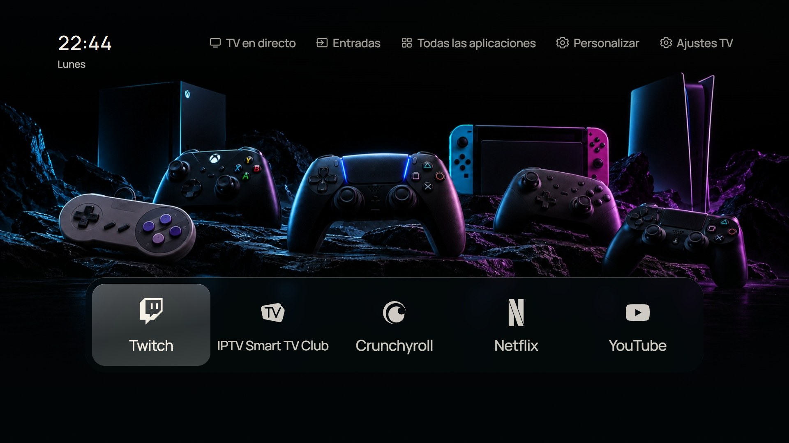

# CleanFrame · Samsung S95B · TV Comedor

Personal launcher for the **Samsung QE65S95BATXXC**, 65-inch S95B OLED (2022), adapted from [nthnclrk/CleanFrame](https://github.com/nthnclrk/CleanFrame). Spanish UI, English/Spanish guides and screenshots.

Menú personal para la **Samsung QE65S95BATXXC**, S95B OLED de 65 pulgadas (2022). Interfaz en español, guías y explicaciones de capturas en ambos idiomas.

**[English guide](docs/comedor/README.en.md) · [Guía en español](docs/comedor/README.es.md)**

[Project record / Registro](docs/comedor/PROJECT.md) · [Screenshots / Capturas](docs/comedor/SCREENSHOTS.md) · [Upstream README](README.upstream.md)



## Confirmed configuration / Configuración confirmada

Samsung QE65S95BATXXC · firmware **T-PTMDEUC-1720.7** · **Tizen 6.5, ARMv7 / 32-bit**.

- Power-on shows broadcast TV; physical Home opens TV Comedor. The owner confirmed the requested power-on/Home test. / Al encender aparece la TDT; Casa abre TV Comedor. El propietario confirmó la prueba solicitada.
- Start with Smart Hub and Autorun Last App were reported disabled in the TV menu. Home routing is configured separately. / En el menú se dejaron desactivadas Iniciar con Smart Hub e Iniciar última aplicación. La asignación de Casa se configura por separado.
- This is evidence for this TV/firmware, not a guarantee for other models, every power state or future firmware. / La evidencia corresponde a esta TV/firmware; otros modelos, estados o actualizaciones requieren pruebas.

## Features / Funciones

- Installed apps, HDMI and optional Live TV shortcuts in a reorderable carousel, with no application-imposed maximum. / Apps instaladas, HDMI y TDT opcional en un carrusel ordenable sin máximo impuesto por la app.
- Scrolling order editor, saved preferences, Back/Home controls. / Editor desplazable, preferencias guardadas y controles Volver/Inicio.
- Monochrome Crunchyroll, SmartTV Club and Twitch, plus other platform and console marks. / Logos monocromos de Crunchyroll, SmartTV Club y Twitch, entre otras plataformas y consolas.
- Editable HDMI names/icons; launcher settings separate from Samsung quick settings. / Nombres e iconos HDMI editables; personalización separada de ajustes Samsung.
- Live TV preview and channel list: focus previews, OK/click tunes and opens full-screen; separate full-screen button retained. / Lista y vista previa de TDT: recorrer previsualiza, OK/clic sintoniza y abre pantalla completa; se conserva el botón independiente.
- 24-hour clock with weekday; 22 backgrounds in 11 day/night pairs, with selected masters and prompts. / Hora de 24 horas con día de la semana; 22 fondos en 11 parejas día/noche, con originales y descripciones.

## Preview / Vista previa

Node.js 22.13+ or 24+, Python 3.10+ and npm:

```sh
git clone https://github.com/pettersdark/Samsung-QE65S95BATXXC-CleanFrame.git
cd Samsung-QE65S95BATXXC-CleanFrame
npm ci
python scripts/preview.py --public-fonts
```

Open http://localhost:4795/home/. Arrows, Enter and Escape mirror remote controls. Use `python3` where required. Real TV actions require hardware. / Abre esa dirección y usa flechas, Intro y Escape. Usa `python3` si corresponde; las acciones de TV requieren el dispositivo real.

## Maintenance and privacy / Mantenimiento y privacidad

Start with the language guide and project record. Older bedroom/upstream documents remain historical references, not S95B compatibility claims. Original SDK identity, certificates, passwords, network addresses, signed widgets and recovery state are private and excluded from Git. Native Home source templates use placeholders and are not an unattended installer.

Consulta la guía y el registro antes de modificar. Los documentos antiguos del dormitorio/proyecto original son referencias históricas. Identidad del SDK, certificados, contraseñas, direcciones de red, paquetes firmados y recuperación quedan privados y fuera de Git. Las plantillas de Inicio usan ejemplos y no son un instalador automático.

Retain [LICENSE](LICENSE) and [THIRD_PARTY_NOTICES.md](THIRD_PARTY_NOTICES.md). Brand owners retain their rights; no endorsement is claimed. / Conserva las licencias y avisos; las marcas pertenecen a sus propietarios.
