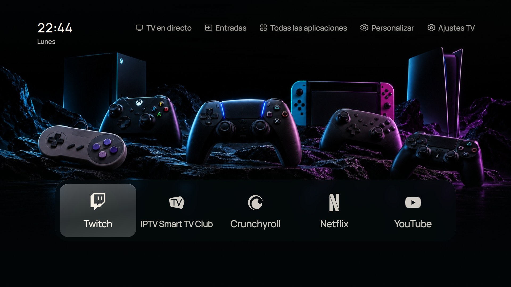
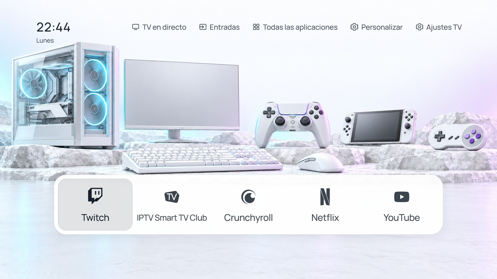
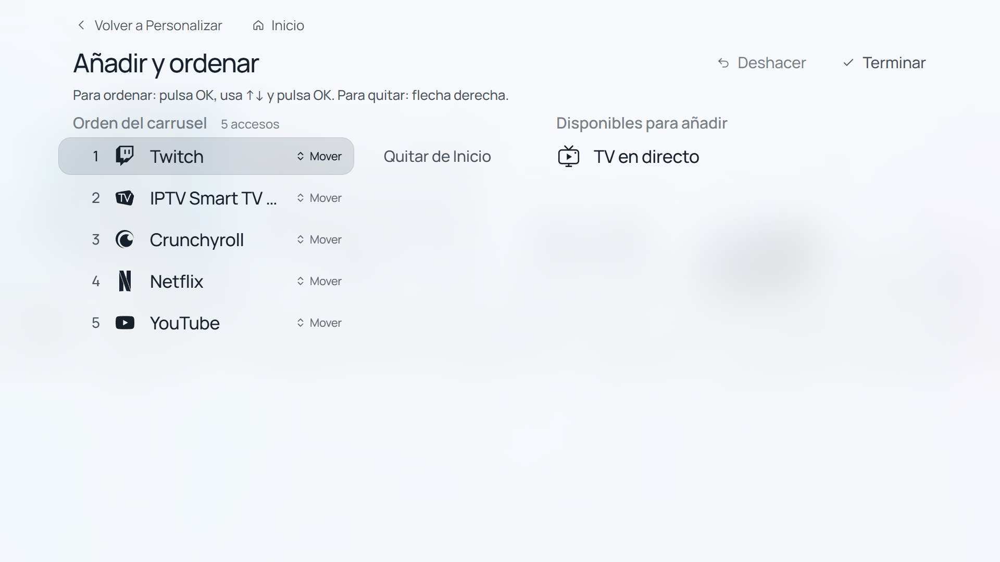

# Screenshots / Capturas

Current browser preview with bundled public fonts and simulated Tizen APIs. Spanish interface, captions in both languages. These are not photographs of the physical S95B or proof of a live broadcast.

Vista previa actual del navegador, con fuentes públicas y API Tizen simuladas. Interfaz en español y explicaciones bilingües. No son fotografías de la S95B ni pruebas de emisión real.

## Night Home / Inicio nocturno

Monochrome Twitch, SmartTV Club and Crunchyroll alongside Netflix and YouTube. Only apps discovered on an actual TV are shown there; this preview supplies a representative simulated catalogue.

Twitch, SmartTV Club y Crunchyroll monocromos junto a Netflix y YouTube. La TV muestra solo apps que descubre instaladas; esta captura usa un catálogo representativo simulado.

## Day Home / Inicio diurno

The same marks use dark theme ink against a light background. Carousel cards retain their size as more shortcuts are added.

Los mismos logos usan tinta oscura sobre fondo claro. Las tarjetas conservan su tamaño al añadir accesos.

## Add and reorder / Añadir y ordenar

Move, remove, undo and save carousel positions using the remote. Long saved lists scroll in the left column; there is no application-imposed nine-item limit.

Mueve, quita, deshaz y guarda posiciones con el mando. Las listas largas se desplazan en la columna izquierda; no hay límite de nueve impuesto por la app.

